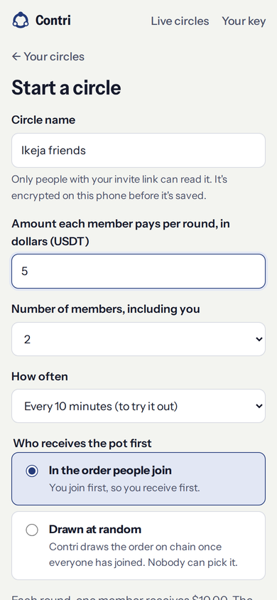
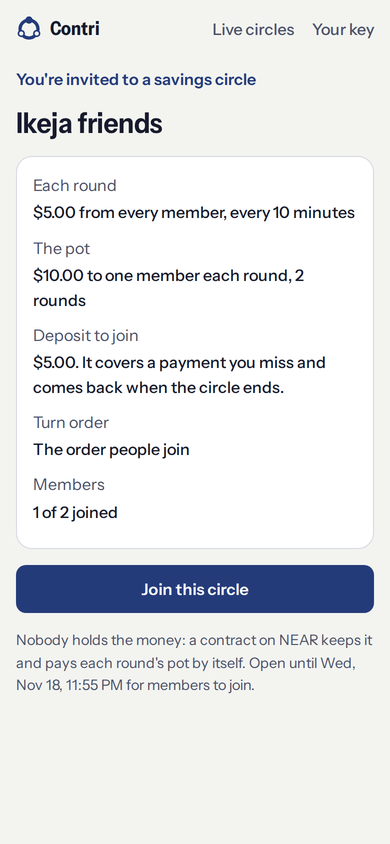
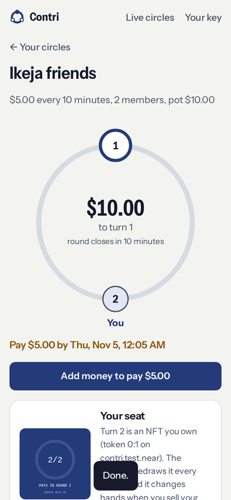
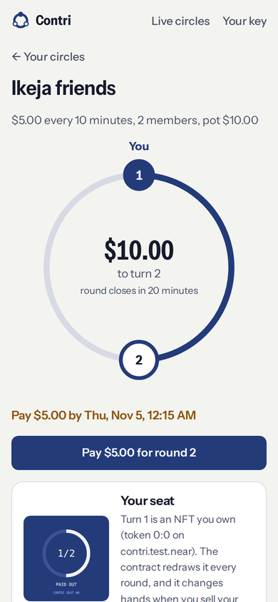

# Contri

Ajo without the collector. Savings circles on NEAR.

Contri runs a rotating savings circle (ajo, esusu, susu, tanda, chit fund) where a NEAR smart contract holds the pot instead of a person. Members sign in with a phone passkey, pay from the chain or exchange where their dollars already are, and the contract pays each turn by itself. A member who needs cash early can buy an earlier turn from someone willing to wait.

Built for NEAR HACKATHON (Nov 1-14, 2026). Tracks: NFTs That Do Something, Real-World Money, Privacy & Private AI, Open Innovation.

<p>




</p>

Screenshots from the automated browser test: two members with passkeys click through a circle in Chromium against the real NEAR Intents contract on a local NEAR network.

## How to test

**Live app:** https://contri.ng. **Contract:** [`circles.contring.near`](https://nearblocks.io/address/circles.contring.near) on NEAR mainnet.

**Run with real money on 5 November 2026**, on an Android phone (Chrome) and an iPhone (Safari), with real passkeys. Circle 0: $1 a round, 2 members, every 10 minutes. The Android member paid through the private balance; the iPhone member topped up straight from a wallet on BNB Smart Chain.

| Step | Transaction |
| --- | --- |
| Contract deployed | [GzzRpgJ…](https://nearblocks.io/txns/GzzRpgJXzz3hoz3jMUioYpdpu8Q8Ag9fPfCzgP9usWHp) |
| Circle created, $1 deposit paid from money moved out of the private balance | [BwMEkbX…](https://nearblocks.io/txns/BwMEkbXbqnfnmu4N8NssHbiv2FXbRFQGtKWhQS2Y44jt) |
| Second member joins, $1 deposit | [Emi3RfF…](https://nearblocks.io/txns/Emi3RfFtsJo8sZaJDLwdKAHg57xNASBA6X99Zt64pfR3) |
| Round 1: first payment | [CANkBfZ…](https://nearblocks.io/txns/CANkBfZx5LsHoktSJr9MvMN9R3gSjjY5C1VEN9VGbXHe) |
| Round 1: last payment, and the $2 pot paid to seat 1 in the same transaction | [4r349ov…](https://nearblocks.io/txns/4r349ov6rHvWg43G5dY1ZLiGJ5n6Zn7Xn1MeZ7KDAuTV) |
| Round 2: first payment | [E38hi5Z…](https://nearblocks.io/txns/E38hi5ZqWPKkWcLY8rEVbjnp3aFGjjoWRjZY3asFbVsT) |
| Round 2: last payment, and the $2 pot paid to seat 2 | [Gtiv9gp…](https://nearblocks.io/txns/Gtiv9gp1J3hn5NU729dL2d5DK9xURnP98YfrurbbfLCy) |
| Circle finished, both deposits returned | [5kN1RW3…](https://nearblocks.io/txns/5kN1RW3fT86pbqQJQQLtCBAd1U6u9p67ir9pJN366UdV) |

Then one member's payout moved into their private balance and the private balance was cashed out to a wallet on BNB Smart Chain; the other cashed out straight to a wallet. The contract ended holding $0. Every money path in the app ran: top up to a circle, top up privately, private balance to a circle, circle to private balance, and cash-outs from both.

### 1. Run a circle with real money (about $6 in, nearly all of it back; 10 minutes)

1. Open the app on your phone and tap **Create a passkey**. No email or phone number is asked for.
2. Tap **Start a circle**: name it, $1 per round, 2 members, every 10 minutes. Tap **Continue**.
3. Tap **Every round: $3.00**, choose **USDT on BNB Smart Chain**, tap **Get a deposit address**, and send that amount from an exchange or wallet. When it arrives, tap **Create circle**. You hold seat 1 and the invite link opens.
4. Open the invite link in a second browser profile (or send it to a friend), create a passkey there, and add $3 the same way. Tap **Join**. The circle starts: the ring shows both seats and the round's deadline.
5. Both members tap **Pay**. The second payment pays the $2 pot to seat 1 in the same transaction. Pay round 2 and seat 2 receives the pot; the circle finishes and both $1 deposits come back.
6. Tap **Move money out** to send a circle account's balance to your private balance (free, about ten seconds) or to an exchange or wallet.

**The private balance.** On the home screen, **Add privately** gives a deposit address that lands money on NEAR Intents' private ledger (Confidential Intents). When you then start, join or pay a circle, the add-money screen offers **Move $X here** from it, so the circle account is funded from the private ledger instead of your exchange. **Cash out** on the home screen sends it to any supported chain.

Every action is a NEP-413 intent signed on the phone and submitted by Contri's relayer, so neither member ever holds NEAR. To watch instead of pay, open **Live circles** in the app: every circle on the contract, read straight from the chain.

### 2. Check the screens offline (no money, no chain)

```
cd app
MOCK=1 node dev/server.js        # http://localhost:8787/app
```

Choose **Other ways in > Keep my key on this device**. The mock API serves two made-up circles (one running, one filling up). Nothing touches a chain.

### 3. Run the tests

```
cd contract && cargo test                 # 72 contract unit tests, incl. a JSON parser fuzzed against serde_json
cd app && npm install && npm test         # app and relayer: keys vs an independent ed25519, NEP-413, borsh, relayer rules
cd app && npm run check                   # type-checks every JS file (JSDoc + tsc --strict)
```

End-to-end, against the real NEAR Intents contract built from [near/intents](https://github.com/near/intents) on a local NEAR sandbox (`contract/sandbox`, run by `.github/workflows/sandbox.yml`):

- `a_whole_circle_through_near_intents`: create, join, a refused join refunded, a seat sale, payouts, a missed payment settled from a deposit, deposits released, circle closed. Every USDT is accounted for and Contri ends at zero.
- `members_with_only_a_key_use_signed_intents`: a member with no NEAR account joins, leaves and pays with signed intents.
- `the_app_runs_a_circle_through_its_relayer`: the app's own JavaScript (passkey-derived keys, invite signatures, encrypted name, versioned nonces) runs a whole circle through the relayer, read proxy and keeper handlers, including a missed round settled by the keeper.
- `the_app_works_in_a_browser`: two members, each in their own Chromium profile with a passkey (a WebAuthn virtual authenticator with PRF), sign up, start a circle, invite, join, top up, pay and get paid by clicking through the real app. Screenshots are published to the `sandbox-results` branch.

## What it does

1. An organizer creates a circle: amount per round, number of members, how often, and whether turns go in join order or are drawn at random.
2. Members join with the invite link and sign in with a passkey. No seed phrase, no NEAR account, no gas token.
3. Each member puts down one contribution as a deposit. It covers a payment they miss and comes back when the circle ends.
4. Each round, members top up from BNB Chain, Solana, Tron, TON, Base, Arbitrum or Ethereum through NEAR Intents' 1Click, and pay.
5. When the last member pays, the contract pays the pot to that round's member. If the deadline passes first, anyone can settle the round from the late members' deposits.
6. Turns are seat NFTs. A member can list their turn and another member with a later turn can buy it; the contract swaps the seats and pays the seller.
7. When the circle ends, deposits go back and each member's record (completed, defaulted, missed payments) is kept on chain.

## Privacy

- **No personal data.** Sign-in is a passkey. Contri never asks for a name, phone number or email, and the site loads no third-party scripts, fonts or trackers (strict CSP).
- **One account per circle.** The app derives a separate ed25519 key for every circle from the passkey's PRF secret, so a member's circles can't be linked to each other on chain. A synced passkey brings them all back on a new phone.
- **Invite-only, encrypted circles.** The invite link's secret (after `#`, never sent to a server) signs joins, which the contract checks with `env::ed25519_verify`, and encrypts the circle's name with AES-GCM before it goes on chain.
- **A private balance.** Each member has one private account on NEAR Intents' private ledger (Confidential Intents), derived from the passkey. Money comes in from an exchange, goes out to circles, comes back with payouts and leaves to any chain, so the public chain never links a circle account to the exchange or wallet behind it. 1Click builds the intents that move it; the phone checks each one moves exactly what the member asked before signing.
- **No logs, no RPC fingerprinting.** The phone reads the chain through Contri's server, which keeps no logs, so no RPC provider sees one IP address looking up several circle accounts.

Full design, what each party can see, the limits (amounts and timing), and what was ruled out: [docs/PRIVACY.md](docs/PRIVACY.md).

## How NEAR is used

- **NEAR Intents as the money layer.** Members' USDT lives in NEAR Intents. A contribution is a `Transfer` intent to the Contri contract with a message, which NEAR Intents delivers to `mt_on_transfer` with the verified signer. Payouts leave through Intents' `mt_transfer`.
- **Signed intents from passkey-derived keys.** Each circle account is an ed25519 implicit account; the app signs NEP-413 payloads with WebCrypto. The relayer checks each payload against what Contri relays, simulates it with `simulate_intents`, then submits `execute_intents` and pays the gas.
- **`AuthCall` intents** for leaving a circle, listing or unlisting a turn, cancelling, and claiming a failed transfer.
- **1Click API** for top-ups from other chains (straight from an exchange withdrawal) and cash-outs to them.
- **Confidential Intents** for the private balance: `CONFIDENTIAL_INTENTS` quotes, a session from `/v0/auth/authenticate` to read the balance, and `/v0/generate-intent` and `/v0/submit-intent` for moves the member's private account signs.
- **Fair draws** from NEAR's per-block random seed when a circle fills.
- **Seats as live NFTs.** NEP-171/177/181 views and events; each seat's picture is an SVG the contract draws from the circle's live state.
- **Community backing from DAOs.** A Trezu or Sputnik DAO treasury can back a circle with one `mt_transfer_call` proposal; the backing covers missed payments ([integrations/trezu](integrations/trezu)).
- **Standards and tooling.** NEP-245 receiver, NEP-297 events, NEP-330 source metadata, and an embedded ABI generated from typed declarations.

## Repository

| Path | What |
| --- | --- |
| `contract/` | The Rust contract (near-sdk 5, under 100 KB), its tests, ABI, and sandbox end-to-end tests |
| `app/public/` | The website and app: plain ES modules, no runtime dependencies, no build step |
| `app/public/js/lib/` | Keys, NEP-413 signing, invites, NEAR transactions; shared by the app and the server |
| `app/api/`, `app/server/` | Relayer, read proxy, 1Click top-up and cash-out, the private balance, keeper (Vercel functions) |
| `app/scripts/` | Mainnet deploy and lock |
| `docs/` | [Architecture](docs/ARCHITECTURE.md), [contract methods](docs/METHODS.md), [privacy](docs/PRIVACY.md), [fees and gas](docs/FEES.md) |

[DEMO.md](DEMO.md) has the 60-second demo script.

## License

MIT
