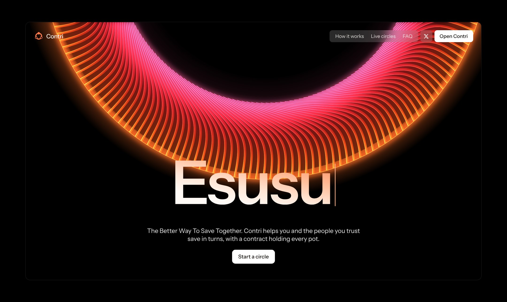
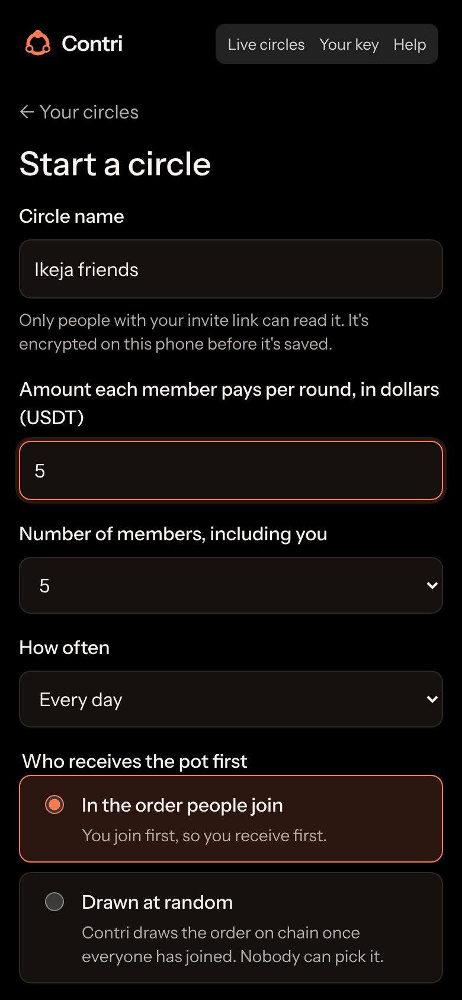
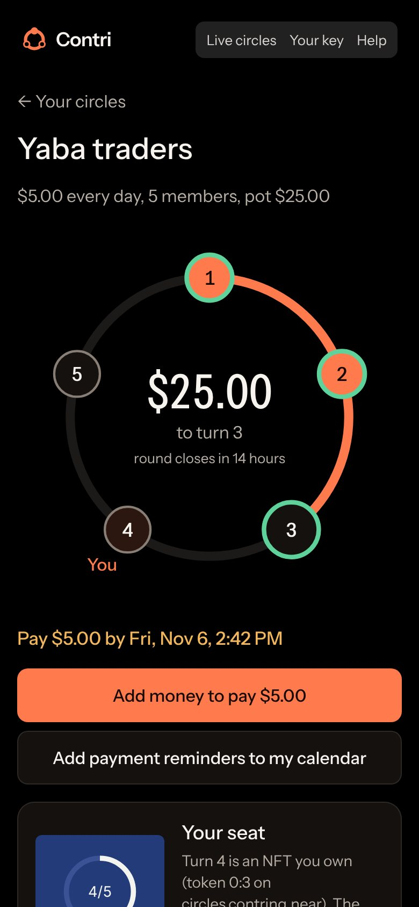
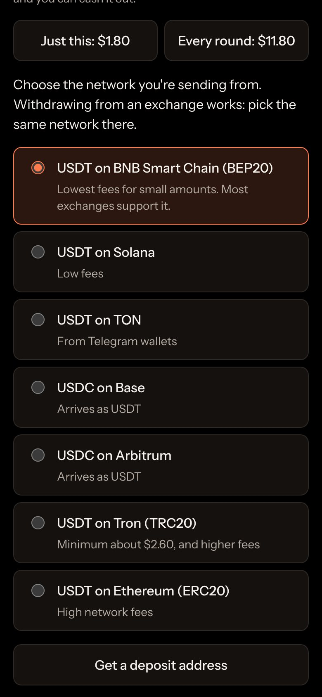
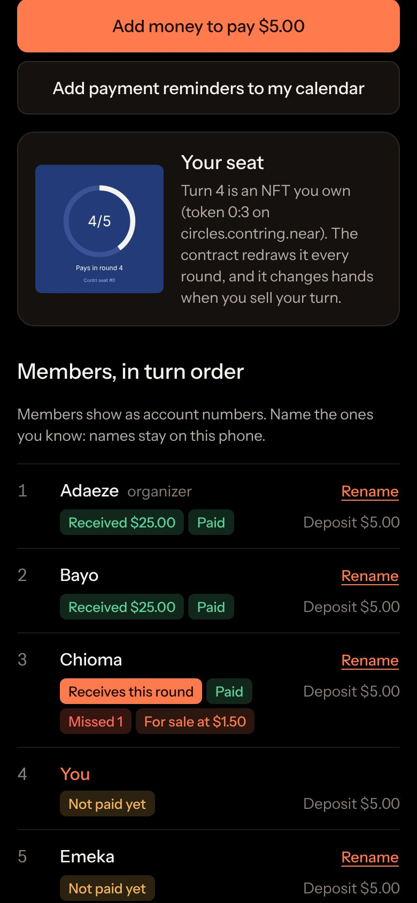
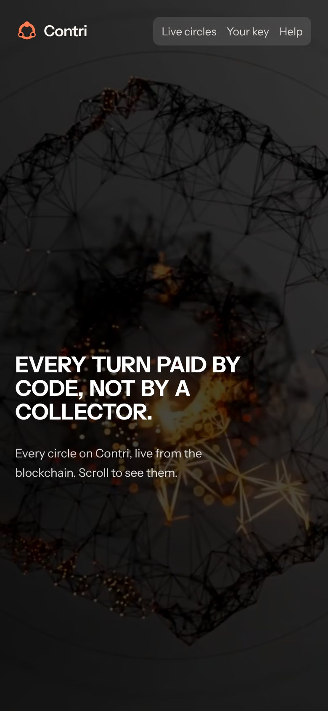

# Contri

Àjọ without the collector. Savings circles on NEAR.

Contri runs a rotating savings circle (àjọ, esusu, adashe, susu, tanda, chit fund) where a NEAR smart contract holds the pot instead of a person. Members sign in with a phone passkey, pay from the chain or exchange where their dollars already are, and the contract pays each turn by itself. A member who needs cash early can buy an earlier turn from someone willing to wait.

Millions of people across Africa, Asia and Latin America save in circles like this. In many, one person collects and holds the pot, and can disappear with it. Savings circles on a blockchain have been tried before; what Contri adds:

- **Nobody holds the pot, not even Contri.** The contract pays each turn by itself, in the same transaction as the round's last payment (a round every member paid ahead goes out on the keeper's next run, within minutes). A late round can be settled by anyone, so a circle always finishes.
- **No crypto knowledge needed.** A phone passkey, no seed phrase, no NEAR account and no gas token. Members pay straight from an exchange withdrawal on BNB Chain, Solana, Tron, TON, Base, Arbitrum or Ethereum.
- **A missed payment has a cost, in code.** A deposit covers it; whatever it doesn't cover is held back from the defaulter's own turn and given to the members who were shorted.
- **Turns can be traded.** Each turn is an NFT seat; a member who needs cash sooner buys an earlier one from someone happy to wait and earn for it.
- **Private by default.** Circle names are encrypted, each circle uses its own account, and money can move through NEAR Intents' confidential private balance, so nothing on chain names a member or links their wallet.
- **Pay once, done.** A member can pay every round ahead; each round then takes its share by itself.

Built for NEAR HACKATHON (Nov 1-14, 2026). Tracks: Real-World Money, Privacy & Private AI, NFTs That Do Something, Open Innovation.

## How to test

**Live app:** https://contri.ng. **X:** [@contri_ng](https://x.com/contri_ng). **Contract:** [`circles.contring.near`](https://nearblocks.io/address/circles.contring.near) on NEAR mainnet, **locked on 7 November 2026** ([QxnCNCi…](https://nearblocks.io/txns/QxnCNCiaTpNwuJaxiDRuU2jtSN66vKWfU7PX9oLfYjG)): the account has no keys, so nobody, Contri included, can change its code or move the money it holds outside its rules. See [Security](#security).

Three ways in, from quickest to most real. None needs a NEAR account.

### 0. One command (about 20 seconds, Node 22, nothing to install)

```
node app/scripts/verify.mjs
```

It runs the app and server tests, starts the app offline, runs a whole circle end to end (two new members top up, create, join, pay two rounds, each gets the pot and their deposit back; every payment is signed by the app's own code and passes the relayer's real checks), then reads mainnet to check what this README claims: the contract has no keys, its code hash is the one given below, and the real-money circle finished with every pot paid. It prints PASS, FAIL or SKIP for each. `--all` adds the contract's unit tests if Rust is installed. CI runs it on every push (`app-results` branch, `verify.log`).

### 1. The app offline, in two minutes (no money, no chain)

Needs Node 22. No install step: the app and its server have no runtime dependencies.

```
cd app
MOCK=1 node dev/server.js        # http://localhost:8787/app  (PORT=8790 to change it)
```

The mock behaves like the real thing, in memory, and touches no chain: a top-up "arrives" a few seconds after you ask for its deposit address (the screen checks every few seconds), and creating, joining and paying update the circles, with the pot paid on the last payment of a round. Two ways in:

- **As a member of two sample circles** (one running, one filling up): choose **Other ways in > Restore from a recovery code** and paste `k7Fa-K87W-HGVX-zkao-Hb7C-dVPg-kKDQ-hZ29-VLDe-BVbD-fYn` (the server prints it too). Open the running circle to see the pot, the turn order, your seat NFT and a turn for sale.
- **As a new member:** choose **Other ways in > Keep my key on this device**, then **Start a circle**, get a deposit address, wait for it to arrive and tap **Create circle**. Open the invite link in a second browser profile to join as the second member.

### 2. The tests

```
(cd contract && cargo test)                # 98 contract unit tests, incl. a JSON parser fuzzed against serde_json and an attacker-view audit's tests
(cd app && npm test)                       # 55 app and server tests: keys vs an independent ed25519, NEP-413, borsh, relayer rules, private-balance checks, the fee, shared rate limits
(cd app && npm install && npm run check)   # type-checks every .js file (JSDoc + tsc --strict)
```

End-to-end, against the real NEAR Intents contract built from [near/intents](https://github.com/near/intents) on a local NEAR sandbox (`contract/sandbox`, run by `.github/workflows/sandbox.yml`, results on the `sandbox-results` branch):

- `a_whole_circle_through_near_intents`: create, join, a refused join refunded, a seat sale, payouts, a missed payment settled from a deposit, deposits released, circle closed. Every USDT is accounted for and Contri ends at zero.
- `members_with_only_a_key_use_signed_intents`: a member with no NEAR account joins, leaves and pays with signed intents.
- `the_app_runs_a_circle_through_its_relayer`: the app's own JavaScript (passkey-derived keys, invite signatures, encrypted name, versioned nonces) runs a whole circle through the relayer, read proxy and keeper handlers, including a missed round settled by the keeper.
- `the_app_works_in_a_browser`: two members, each in their own Chromium profile with a passkey (a WebAuthn virtual authenticator with PRF), sign up, start a circle, invite, join, top up, pay and get paid by clicking through the real app.
- `the_deploy_script_creates_upgrades_and_locks_the_contract`: the mainnet deploy script creates the contract account, upgrades it, and locks it (deletes every key, then checks NEAR Intents holds none for it).
- `the_payout_callback_fits_its_gas_floor_in_the_biggest_circle`: a 20-member circle's last round, the costliest payout callback, measured at 5.5 Tgas against its 30 Tgas floor.

After every deploy, `.github/workflows/web.yml` checks the live site the way visitors reach it: every page, file, redirect and API route (`scripts/site-check.mjs`), every screen in a real browser (`app/scripts/live-browser.mjs`), staying signed in through a dropped tab and a browser restart in Chromium, WebKit and Firefox with Android, iPhone and desktop profiles (`app/scripts/live-sessions.mjs`), and the 1Click and private-balance calls with an empty account (`scripts/live-check.mjs`). Results go to the `web-results` branch.

### 3. On mainnet, with real money

**Watch without paying:** open **Live circles** at https://contri.ng/app#/explore. It shows every open, running or finished circle on the contract, read from the chain through Contri's server.

**Run with real money on 7 November 2026**, on an Android phone (Chrome) and an iPhone (Safari), with real passkeys, on the code that was then locked (code hash `8EdJpNPWkRQZ1ZnkzJwX6M3B984fvfGseh9wtBUvicSC`, the same as CI's build). Circle 7: $1 a round, 2 members, every 10 minutes.

| Step | Transaction |
| --- | --- |
| Circle 7 created; the organizer pays the $1 deposit and takes seat 1 | [4ieJcHg…](https://nearblocks.io/txns/4ieJcHgNETzt8NrbU2dB6gKNeQ3ZSFGQD2vbRbpQEgN9) |
| Second member pays the $1 deposit and joins; the circle starts | [Hou3U9j…](https://nearblocks.io/txns/Hou3U9j1ELZnF22g1QQXmNefiu11zYSUcc8cpAxprriq) |
| Round 1: first payment | [CbVUzbE…](https://nearblocks.io/txns/CbVUzbEuGUmKNhodPkgzvWk7pKitbuy7YKgU3Qg7fCuf) |
| Round 1: last payment, and the $2 pot paid to seat 1 in the same transaction | [GVs8hmx…](https://nearblocks.io/txns/GVs8hmxi4ZSQ1jBFNTKf8GbQGYYjynGCHEVttnMe2327) |
| Round 2: first payment | [3ed96vU…](https://nearblocks.io/txns/3ed96vUENASX8fqn5td9wNGi4hT2XEyXAYunJZyJFSfh) |
| Round 2: last payment, the $2 pot paid to seat 2, and the circle finished, in one transaction | [CTq2BVe…](https://nearblocks.io/txns/CTq2BVedNKJsaCDSawDPvs83BChmV3ZEhuyP7Ydt1jAJ) |
| Both $1 deposits sent back by the keeper, six seconds later | [2sugJcU…](https://nearblocks.io/txns/2sugJcUq2MNwLfDGNmq84UFp2rpuwFE2k8ECNWi96vuE) |

Both payouts and both deposits went back to the members, and the contract ended holding $0. Contri's keeper doesn't close finished circles, so circle 7 shows under **Live circles** unless someone closes it (anyone may, once it is settled); its transactions stay on chain either way. An earlier run on 5 November used an older contract version.

**Run one yourself** (about $6 in, nearly all of it back; 10 minutes):

1. Open https://contri.ng/app on your phone and tap **Create a passkey**. No email or phone number is asked for.
2. Tap **Start a circle**: name it, $1 per round, 2 members, every 10 minutes. Tap **Continue**.
3. Tap **Every round: $3.00**, choose **USDT on BNB Smart Chain**, tap **Get a deposit address**, and send that amount from an exchange or wallet. When it arrives, tap **Create circle**. You hold seat 1 and the invite link opens.
4. Open the invite link in a second browser profile (or send it to a friend), create a passkey there, and add $3 the same way. Tap **Join**. The circle starts: the ring shows both seats and the round's deadline.
5. Both members tap **Pay**. The second payment pays the $2 pot to seat 1 in the same transaction. Pay round 2 and seat 2 receives the pot; the circle finishes and both $1 deposits come back.
6. Tap **Move money out** to send a circle account's balance to your private balance (free, about ten seconds) or to an exchange or wallet.

**The private balance.** On the home screen, **Add privately** gives a deposit address that lands money on NEAR Intents' private ledger (Confidential Intents). When you then start, join or pay a circle, the add-money screen offers **Move $X here** from it, so the circle account is funded from the private ledger instead of your exchange. **Cash out** on the home screen sends it to any supported chain.

Every circle action is a NEP-413 intent signed on the phone and submitted by Contri's relayer, so neither member ever holds NEAR.

<p></p>

<p>





</p>

The current app on a phone, with sample circles.

## What it does

1. An organizer creates a circle: amount per round, number of members, how often, and whether turns go in join order or are drawn at random.
2. Members join with the invite link and sign in with a passkey. No seed phrase, no NEAR account, no gas token.
3. Each member puts down one contribution as a deposit. It covers one payment they miss and comes back when the circle ends. A missed payment their deposit doesn't cover, they owe: it is held back from their own turn's pot and goes to the members whose pots were short. A member who takes an early pot and then stops paying is covered by their deposit, then by any backing; after that, later pots are short. Contri can't make anyone pay, so circles are for people who trust each other.
4. Each round, members top up from BNB Chain, Solana, Tron, TON, Base, Arbitrum or Ethereum through NEAR Intents' 1Click, and pay. A member can also pay every round left at once: each new round then takes their share by itself, so nobody has to remember to pay.
5. When the last member pays, the contract pays the pot to that round's member. If the deadline passes first, anyone can settle the round from the late members' deposits.
6. Turns are seat NFTs. A member can list their turn and another member with a later turn can buy it; the contract swaps the seats and pays the seller.
7. When the circle ends, deposits go back and each member's record (completed, defaulted, missed payments) is kept on chain.

## Privacy

- **No personal data.** Sign-in is a passkey. Contri never asks for a name, phone number or email, and the site loads no third-party scripts, fonts or trackers (strict CSP).
- **One account per circle.** The app derives a separate ed25519 key for every circle from the passkey's PRF secret, so circle accounts aren't linked by keys on chain. A synced passkey brings them all back on a new phone. Passkeys only work on contri.ng, so a recovery code backs the passkey up, including if the site goes away.
- **Every top-up and cash-out takes the confidential route.** Contri asks 1Click for NEAR Intents' confidential route, so a deposit address can't be looked up to find the circle account it paid, or the wallet it came from (1Click's public status answers 404; after every deploy a live check asserts it for a top-up address).
- **Invite-only, encrypted circles.** The invite link's secret (after `#`, which browsers never send to a server) signs joins, which the contract checks with `env::ed25519_verify`, and encrypts the circle's name with AES-GCM before it goes on chain.
- **A private balance.** Each member has one private account on NEAR Intents' private ledger (Confidential Intents), derived from the passkey. Money comes in from an exchange, goes out to circles, comes back with payouts and leaves to any chain, so no address on the public chain links a circle account to the exchange or wallet behind it, and amounts and timing can be spread out. 1Click builds the intents that move it; before signing, the phone checks each one is a single transfer of the amount asked, from the member's private account, to the deposit address that came with the quote.
- **No application logs, no RPC fingerprinting.** Contri's code writes no logs and stores no requests, only rate-limit counts that expire after two minutes. Vercel, which hosts it, keeps standard request logs (time, path, browser and IP address) for an hour. The phone reads the chain through Contri's server, so no RPC provider sees one IP address looking up several circle accounts.
- **What can still link activity.** Amounts and timing (a $3.02 withdrawal and a $3.00 top-up a minute later), and private-balance moves, where 1Click and Contri's server see the private account and the circle account together. Where a passkey can't give a PRF secret, the app can keep a key in the browser instead, unencrypted, like a hot wallet; the app says so.

Full design, what each party can see, the limits (amounts and timing), and what was ruled out: [docs/PRIVACY.md](docs/PRIVACY.md).

## Security

- **The contract is locked and has no admin method.** Its code can't pay anyone outside a circle's rules, and since 7 November 2026 its account has no keys ([lock transaction](https://nearblocks.io/txns/QxnCNCiaTpNwuJaxiDRuU2jtSN66vKWfU7PX9oLfYjG)), so nobody can upgrade it or move its money. `node app/scripts/deploy.js --lock` refused unless the deployed code was exactly CI's build (code hash `8EdJpNPWkRQZ1ZnkzJwX6M3B984fvfGseh9wtBUvicSC`), swapped the deploy key for a one-time key, checked NEAR Intents holds no key for the account and still lets it pay out, then deleted the one-time key and checked none were left. NEAR Intents' own governance (its DAO and roles) can still pause, freeze or force-move balances held on `intents.near`, and Tether can freeze USDT.
- **Four rounds of AI-assisted security review before the lock** (5 to 7 November 2026; the third with eight independent auditors: contract, economics, server, on-chain, privacy, front end, integrations and a cold judge; the fourth a fresh review of the live build, which found nothing above Low). They found storage that could run out under a running circle, transfers and callbacks that could run short of gas, a member who never paid still collecting their turn, a relayer anyone could lock up or use for free, invitees choosing their own deposit, and smaller issues. Each fix has a test; what was accepted instead is listed with its reason.
- **Every circle can finish.** Members reserve the storage their payouts and credits will need when they join, an empty round closes without a transfer, a round always gets a full period after the one before it, and anyone can settle a late round or release deposits.
- **What it doesn't promise.** A deposit covers one missed round, so a member who takes an early pot and stops paying can leave later pots short (what anyone still owes at their own turn is held back from it). Random turn order uses NEAR's block seed and is best effort: block producers could bias it.

Who can do what, every finding and its fix, and what's still open: [docs/SECURITY.md](docs/SECURITY.md).

## Sustainability

- **Circles are free; money in and out pays 0.25%.** Contributions, payouts, deposits and turn trades carry no fee. Top-ups from another chain and cash-outs to one carry a 0.25% fee, which 1Click takes from what is sent and shares between Contri and itself (`appFees`, set on the server, shown before every confirm, never on moves between a member's own balances). A member of a $5, five-person circle moves about $30 in and $30 out, so Contri's share is about 7 cents; the gas Contri pays for that member's payments is about 0.01 to 0.02 NEAR.
- **Costs little to run.** Storage is paid in NEAR the contract holds (under 0.005 NEAR per member while a circle runs, most of it freed when the circle closes; each member's 117-byte track record stays), and the relayer pays about 0.001 to 0.002 NEAR of gas per payment. The fee lands as USDT in the relayer's NEAR Intents balance; Contri swaps it for the NEAR the relayer spends on gas, by hand for now.
- **Little to maintain.** Once locked, the contract can't be upgraded, so it can't be broken by an update either. The app and server are plain JavaScript with no runtime dependencies or build step.
- **It runs without Contri.** The contract's methods and the app's signing code are public; anyone can run the relayer and keeper, or call the contract from any NEAR account. See [Run your own Contri](#run-your-own-contri).

## How NEAR is used

- **NEAR Intents as the money layer.** Members' USDT lives in NEAR Intents. A contribution is a `Transfer` intent to the Contri contract with a message, which NEAR Intents delivers to `mt_on_transfer` with the verified signer. Payouts leave through Intents' `mt_transfer`.
- **Signed intents from passkey-derived keys.** Each circle account is an ed25519 implicit account; the app signs NEP-413 payloads with WebCrypto. The relayer checks each payload against what Contri relays, simulates it with `simulate_intents`, then submits `execute_intents` and pays the gas.
- **`AuthCall` intents** for leaving a circle, listing or unlisting a turn, cancelling, and claiming a failed transfer (`claim_credit`, offered on the home screen when there is a credit).
- **1Click API** for top-ups from other chains (straight from an exchange withdrawal) and cash-outs to them.
- **Confidential Intents** for the private balance: `CONFIDENTIAL_INTENTS` quotes, a session from `/v0/auth/authenticate` to read the balance, and `/v0/generate-intent` and `/v0/submit-intent` for moves the member's private account signs.
- **Random draws** from NEAR's per-block random seed when a circle fills. Best effort: no member can pick the order, but block producers could bias it.
- **Seats as live NFTs.** NEP-171/177/181 views and events; each seat's picture is an SVG the contract draws from the circle's live state.
- **Community backing (in the contract).** Any account can back a circle with `back:<circle>`, for example a Sputnik DAO proposal (template in [integrations/trezu](integrations/trezu)); the backing covers missed payments. It is unit-tested; the app doesn't show backing yet, and the template hasn't been run against a live DAO.
- **Standards and tooling.** NEP-245 receiver, NEP-297 events, NEP-330 source metadata, and an embedded ABI generated from typed declarations.

## Run your own Contri

The app and server are plain JavaScript with no runtime dependencies. To run them against the same contract (for example if contri.ng ever goes away):

```
cd app
CONTRI_ACCOUNT_ID=circles.contring.near \
RELAYER_ACCOUNT_ID=<a NEAR account with some NEAR for gas> RELAYER_KEY=<its ed25519 key> \
ONECLICK_API_KEY=<a 1Click partner key, for the confidential route and the private balance> \
node dev/server.js
```

`CONTRI_ACCOUNT_ID` matters: every member's keys are derived from the contract's id, so the same recovery code finds the same accounts only against `circles.contring.near`. Restore with **Other ways in > Restore from a recovery code**; passkeys made on contri.ng don't work on another site. Without a 1Click key, top-ups and cash-outs still work but not by the confidential route, and the private balance is off.

## Repository

| Path | What |
| --- | --- |
| `contract/` | The Rust contract (near-sdk 5, about 100 KB), its tests, ABI, and sandbox end-to-end tests |
| `app/public/` | The website and app: plain ES modules, no runtime dependencies, no build step |
| `app/public/js/lib/` | Keys, NEP-413 signing, invites, NEAR transactions; shared by the app and the server |
| `app/api/`, `app/server/` | Relayer, read proxy, 1Click top-up and cash-out, the private balance, keeper (Vercel functions) |
| `app/scripts/` | Mainnet deploy and lock |
| `docs/` | [Architecture](docs/ARCHITECTURE.md), [contract methods](docs/METHODS.md), [privacy](docs/PRIVACY.md), [security](docs/SECURITY.md), [fees and gas](docs/FEES.md) |

[DEMO.md](DEMO.md) has the demo script written before the build.

## License

MIT
